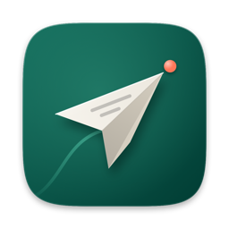
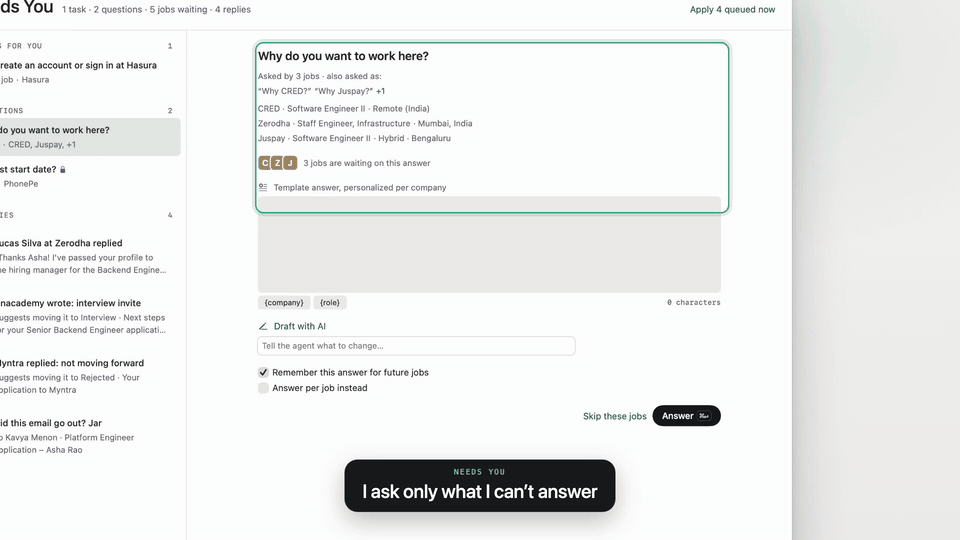

<div align="center">



# AutoApply

**A Mac app that finds jobs, applies for you, and asks only when it doesn't know the answer.**

[](https://github.com/Moaksh/auto-apply/releases)
[](LICENSE)
[](#requirements)
[](app/Package.swift)
[](engine/pyproject.toml)
[](https://www.anthropic.com/claude)

[Download](#install) · [Features](#features) · [How it works](#how-it-works) · [Privacy & safety](#privacy--safety) · [Build from source](#build-from-source)

</div>

---

AutoApply runs on your Mac. It watches job boards and company career pages, scores each opening
against your resume, fills in the application forms, and stops to ask you only for things it
can't know, like your notice period or whether you need a visa. It keeps track of every
application, and it can also find startups near you and draft cold emails to the right people.

It uses your own Claude login to think, keeps your data on your Mac, and never sends anything you
haven't allowed.

[](docs/media/demo.mp4)

<sub>A short loop of the app. Click it for the full one-minute video.</sub>

> [!NOTE]
> AutoApply is in beta. Releases are pre-releases, and the app updates itself from 0.1.1 onward.
> It submits real job applications in your name, so it starts in Review mode: nothing is sent
> until you approve it.

## Features

**Finding jobs**
- Searches public job boards and company career sites: Greenhouse, Lever, Ashby, Workday,
  SmartRecruiters, Workable, Recruitee, company career pages and Google Jobs. LinkedIn and
  Glassdoor are read at human pace, read-only.
- New installs start with a list of verified company boards so there are real forms to fill on the
  first run. Add or remove companies in Settings, or paste any apply link (⌘N) to queue one job.
- Skips postings that are already closed and flags ones that look suspicious, such as a fee asked
  of the candidate or an agency post with no employer named.

**Match scores with evidence**
- Every job gets a 0–100 match score against your resume and preferences, with the reasons behind
  it, so you can see why a job ranked where it did.

**Asks only what it can't answer**
- Before a run, a Prep pass reads the forms ahead and collects every question it can't answer
  from your profile. Similar questions are grouped, so one answer can unblock several jobs.
- They wait in **Needs You**. Sign-ins, CAPTCHAs and verification codes are kept apart from form
  questions.
- **Draft with AI** writes an answer from your profile and resume. Refine it by asking ("shorter",
  "mention my Kafka project"); press Tab to take it.
- Answers are remembered for next time.

**Review before anything is sent**
- In Review, each application shows the filled form, the resume it picked and the cover letter.
  Approve one or several at once.
- Approve waits five seconds with **Undo** before the application goes out.
- If a job can't be sent yet (you applied to that company recently, or an earlier attempt is
  unconfirmed), Review says why and when it can go.

**Autonomy you grant per site**
- Start in Review. After 10 clean approvals in a row on a job site, the app offers to switch that
  site to Auto. You choose the mode globally, per site, per company or per job, and can change it
  at any time.
- When a site needs an account before showing the form (Workday, iCIMS, Taleo), the agent can sign
  up with your connected email, confirm it from your inbox, and keep a unique password for that
  site in your Keychain.

**Pipeline and your day**
- A **Pipeline** board from Discovered to Offer. Drag a job to Queued to apply now, or to Applied
  if you applied yourself. Rejected and ghosted jobs fold into a quiet Closed drawer.
- **Today's ten minutes** on the Dashboard lists what's waiting for you with time estimates and
  walks you through it. A timeline shows today's applications, replies and follow-ups.
- Notifications you can act on: answer short questions or approve applications from the
  notification itself. Rejections never notify you.
- A **menu bar** item shows what the agent is doing and lets you pause or resume it.

**Cold email**
- **Startups near you**: finds startups in your country from YC's company directory and funding
  news, with last round, investors, team size and a link to the source. Facts that aren't on the
  source page stay blank.
- Ranks them 0–100 with the reasons: how recently they raised, stage, investors, YC backing, team
  size, matching open roles and fit with you.
- **Finds people** to write to, founders and engineering leads first at small startups, and shows
  your LinkedIn connections there for referrals and warm intros.
- Drafts each email for you, underlining any claim it can't back up from your profile. Nothing is
  sent until you approve it, and sending stays within a daily limit and a send window.

**Also**
- **Interview prep** packs grounded in the job description, the company and your own story bank,
  and **insights** from your own outcomes: whether higher match scores really hear back more,
  why jobs get skipped, skills that keep coming up, and how each resume variant performs.
- **Explore with sample data** during onboarding, before you set anything up.
- **Report a Bug** from the Help menu opens a GitHub issue with your app version and redacted logs
  filled in.

## How it works

```
 AutoApply.app (SwiftUI)                      autoapplyd (Python, LaunchAgent)
 ┌──────────────────────────┐   Unix socket   ┌─────────────────────────────────────┐
 │ Dashboard · Pipeline     │ ◀────────────▶  │ Discover → Score → Prep → Apply     │
 │ Needs You · Review       │  commands and   │ Cold email · schedule · guardrails  │
 │ Cold Email · menu bar    │  live events    │                                     │
 └────────────┬─────────────┘                 └───┬──────────────┬──────────────┬───┘
              │ reads (read-only)                 │ writes       │ drives       │ asks
              ▼                                   ▼              ▼              ▼
        ┌─────────────────────────────────────────────┐  ┌──────────────┐ ┌─────────────────┐
        │ SQLite in ~/Library/Application Support/... │  │ Agent Chrome │ │ Claude, via     │
        └─────────────────────────────────────────────┘  │ (own profile)│ │ your `claude`   │
                                                         └──────────────┘ │ login           │
                                                                          └─────────────────┘
```

- **`autoapplyd`** is a local background agent. It runs on a schedule (09:00, 13:00 and 18:00 by
  default, and once on wake if a run was missed), and it is the only process that writes the
  database.
- **The app** reads the database directly and sends every change to the agent over a Unix socket
  in your AutoApply folder.
- **Forms** on known job sites are filled by scripted Playwright adapters. Unusual forms are
  handled by Claude driving a browser through the Playwright MCP server, behind a gate that blocks
  submit until the guardrails pass.
- **Claude** is reached through the Claude Agent SDK, using the Claude Code login already on your
  Mac. There is no separate API key and no AutoApply server.

The full design is in [`PLAN.md`](PLAN.md), and the contract between app and agent is in
[`contract/`](contract/).

## Privacy & safety

**Your data stays on your Mac.** The database, resumes, cover letters, screenshots and the agent's
browser profile live in `~/Library/Application Support/AutoApply/`. There is no AutoApply
account, server or telemetry. The only thing that leaves your Mac is what Claude needs to do the
work (resume and profile text, job descriptions, form questions and generated answers), sent with
your own Claude login, plus the applications and emails you approve.

**Secrets live in the macOS Keychain.** Job-site account passwords, your mailbox app password and
any email-finder API key are stored only in the Keychain. LinkedIn and Glassdoor sessions stay in
the agent's own Chrome profile; AutoApply never stores those passwords.

AutoApply submits real job applications in your name. These guardrails are built in:

- **No double applies.** `submitting` is committed to the database *before* the submit click. If
  the agent crashes mid-submit, the application becomes "unconfirmed" and is **never retried
  automatically**; you confirm in the app whether it went through. An adapter that is sure it
  clicked nothing reports `failed` instead.
- **Caps and cooldown are checked right before the click.** The daily cap (default 15) counts
  in-flight and unconfirmed attempts as well as confirmed ones. The per-company cooldown (default
  one application per company every 30 days) also holds a company while an earlier attempt there
  is unconfirmed. Both are in Settings ▸ Guardrails.
- **Kill switch.** Pause (⌘⇧P, the menu bar, or `pause_all`) is checked between every agent step
  and answered even while a slow command is running.
- **Never guess.** Work authorization, sponsorship, salary, notice period, EEO and similar answers
  come only from the facts you entered; when a fact is missing, the job waits in Needs You.
  Generated answers below the confidence threshold wait too, and cover letters are fact-checked
  against your profile and stories.
- **Review mode** (globally, or per site, company or job) stops each application before it is
  sent. Nothing goes out until you approve it, approval has a five-second Undo, and the agent can
  never approve its own work.
- **The browser agent cannot click submit on its own.** A tool gate denies submit-like clicks,
  Enter-to-submit and script evaluation until a submit request passes the guardrails, and then
  allows exactly one click.
- **LinkedIn and Glassdoor are read-only.** They run in a visible browser at human pace, at most
  3 sessions a day, and only listing pages are read. The agent never clicks Apply there and never
  uses Easy Apply. Easy Apply jobs go to a manual list with drafted copy-paste answers.
- **Cold email is opt-in and approval-only.** Every email is a draft until you approve it. Sending
  is spread over a send window, capped per day (default 10 new threads), and checks a
  do-not-contact list right before each message.

Tests never touch the network or a real LLM, and never submit a real application. See
[`SECURITY.md`](SECURITY.md) to report a vulnerability.

## Install

### Requirements

- A Mac with Apple silicon, running **macOS 26** or later
- A **Claude** account, logged in to [Claude Code](https://claude.com/claude-code) (the agent uses
  it to think)
- **Google Chrome**, **uv** and **Node.js**. You don't need to install these first: the app's
  System check installs anything missing with one click each.

### Download

1. Download the latest `AutoApply-<version>.dmg` from
   [Releases](https://github.com/Moaksh/auto-apply/releases).
2. Open it and drag **AutoApply** into **Applications**.
3. The first time, right-click AutoApply in Applications and choose **Open**, then **Open** again.
   This beta isn't notarized by Apple yet, so a normal double-click is blocked once. If macOS still
   refuses, go to System Settings ▸ Privacy & Security and click **Open Anyway**.
4. Follow the setup. The System check installs what's missing, then **Install agent** sets up the
   background agent (a few minutes the first time). You can explore with sample data before you
   connect anything.

Updates: 0.1.1 and later update themselves and keep your data.

## Build from source

You need Xcode 26 (or a Swift 6.4 toolchain), [uv](https://docs.astral.sh/uv/), Node.js, Google
Chrome and a logged-in `claude` CLI.

```bash
git clone https://github.com/Moaksh/auto-apply.git auto_apply && cd auto_apply

# Engine
cd engine
uv sync                                   # creates engine/.venv and installs deps + dev tools
uv run playwright install chromium        # browser for the scripted ATS adapters
uv run pytest -q                          # ~1,460 tests, no network, no real LLM
cd ..

# App
cd app
swift build                               # or: open Package.swift   (opens in Xcode; run the AutoApply scheme)
swift test                                # Swift Testing: AutoApplyTests + C3Tests
cd ..

# A double-clickable app
cd engine && uv run autoapply init && cd ..   # first run: creates ~/Library/Application Support/AutoApply
app/scripts/make_app.sh                       # release build -> app/build/AutoApply.app (ad-hoc signed)
open app/build/AutoApply.app
```

The app connects to the agent but doesn't start it. Run `cd engine && uv run autoapplyd
--no-scheduler` in a terminal, or install the LaunchAgent from Settings ▸ Agent. To try the UI with
no agent at all, run `cd app && AUTOAPPLY_MOCK=happyRun swift run AutoApply`.

[`docs/DEVELOPMENT.md`](docs/DEVELOPMENT.md) covers the rest: running the daemon and the
LaunchAgent, mock scenarios, the developer CLI, the end-to-end test, environment variables, a
project map, regenerating the protocol, release builds and troubleshooting.

## Contributing

Bug reports, ideas and pull requests are welcome. The quickest way to report a bug is
**Help ▸ Report a Bug…** in the app, which fills in your version and redacted logs. Read
[`CONTRIBUTING.md`](CONTRIBUTING.md) before opening a pull request, and please follow the
[Code of Conduct](CODE_OF_CONDUCT.md).

## License

AutoApply is released under the [MIT License](LICENSE). Some engine code is adapted from
career-ops (also MIT); see [`THIRD_PARTY_NOTICES.md`](THIRD_PARTY_NOTICES.md).

AutoApply applies to jobs in your name. You are responsible for what it submits and for following
the terms of the sites it uses.
